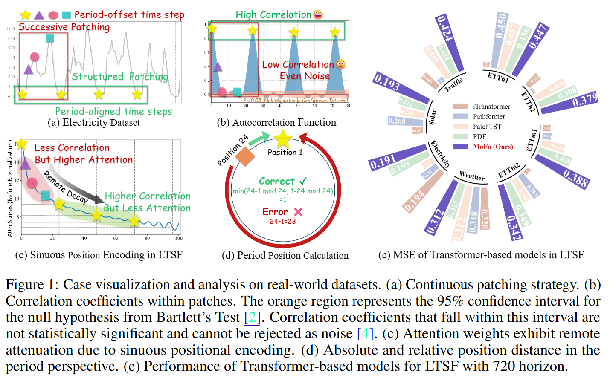

<div align="center">

# MoFo: Empowering Long-term Time Series Forecasting with Periodic Pattern Modeling

[](https://neurips.cc/Conferences/2025)

[](LICENSE)
[](https://www.python.org/) [](https://pytorch.org/)

<p align="center">
  <a href="#11-coding-framework">Code framework</a> |
  <a href="#3-reproduction-of-the-long-term-time-series-forecasting">Reproduction</a> |
  <a href="#-citation">Citation</a> |
  <a href="#-license">License</a>
</p>

</div>

This is the official repository of our NeurIPS 2025 Paper. This paper introduces MoFo, which interprets periodicity as both the correlation of period-aligned time steps and the trend of period-offset time steps. We first design period-structured patches—2D tensors generated through discrete sampling—where each row contains only period-aligned time steps, enabling direct modeling of periodic correlations. Period-offset time steps within a cycle are aligned in columns. To capture trends across these offset time steps, we introduce a period-aware modulator. This modulator introduces an adaptive strong inductive bias through a regulated relaxation function, encouraging the model to generate attention coefficients that align with periodic trends. This function is end-to-end trainable, enabling the model to adaptively capture the distinct periodic patterns across diverse datasets. Extensive empirical results on popular benchmark datasets demonstrate that MoFo achieves competitive performance compared to 17 advanced baselines, while offering up to 14x memory efficiency gain and 10x faster training speed.



## 1. Introduction about the code
### 1.1 Coding Framework
All of our experiments are running on the [TFB](https://github.com/decisionintelligence/TFB) coding framework. To run MoFo, you need to configure your environment and datasets according to their requirements.

`Since the framework, details, and environment of TFB have been updated, the current MoFo code is no longer applicable. With the help of the official TFB team, we will promptly update MoFo's code and results to align with the latest TFB framework before the final revision deadline for NeurIPS 2025.`

<br>

## 2. Environmental Requirments
The experiment requires the same environment as [TFB](https://github.com/decisionintelligence/TFB).

<br>

## 3. Reproduction of the Long-term Time Series Forecasting
The experimental running on MoFo are integrated within file `/scripts/MoFo_Example.sh`. You can run it through the following commands,
```
sh MoFo_Example.sh
```
Other hyperparameters can be seen in the Appendix of Paper.

## 📄 Citation

If you find this repository useful, please cite our paper:

```bibtex
@inproceedings{ma2025mofo,
  title     = {{MoFo}: Empowering Long-term Time Series Forecasting with Periodic Pattern Modeling},
  author    = {Ma, Jiaming and Wang, Binwu and Huang, Qihe and Wang, Guanjun and Wang, Pengkun and
               Zhou, Zhengyang and Wang, Yang},
  booktitle = {Advances in Neural Information Processing Systems (NeurIPS)},
  year      = {2025}
}
```

## 🙏 Acknowledgements

Our experiments are built on the [TFB](https://github.com/decisionintelligence/TFB) benchmark framework.

## 📜 License

The code in this repository is released under the [MIT License](LICENSE).
